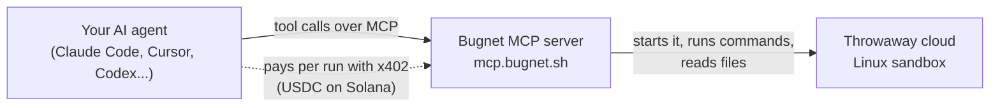

# Bugnet

Your AI coding agent runs risky or heavy code in a throwaway cloud Linux sandbox instead of on
your computer, and pays for it per run.

<!-- PENDING: .github/workflows/ci.yml is built on another branch, and @bugnet/mcp is not on npm yet -->

[](https://github.com/bugnet-sh/bugnet/actions/workflows/ci.yml)
[](https://www.npmjs.com/package/@bugnet/mcp)
[](https://www.npmjs.com/package/@bugnet/mcp)
[](#license)
[](https://github.com/bugnet-sh/bugnet/stargazers)
[](https://github.com/bugnet-sh/bugnet/commits)

You ask your agent to try a GitHub repo someone sent you, or to get an AI model running. Bugnet
lets the agent do that on a fresh cloud machine. Your files, keys and network stay out of reach.
When the time is up, the machine and everything on it are deleted.

- **No account and no API key.** Your agent pays per run in USDC on Solana with x402.
- **Works with the agent you already use.** Claude Code, claude.ai, Cursor, VS Code, Codex,
  Devin Desktop (formerly Windsurf), or any other MCP client.
- **No AI on our side.** Bugnet is plain code. Your own agent does the thinking.

## Contents

- [How it works](#how-it-works)
- [Quick start](#quick-start)
- [Install](#install)
- [Tools](#tools)
- [Paying](#paying)
- [Security model](#security-model)
- [Limits](#limits)
- [FAQ](#faq)
- [License](#license)

## How it works



1. You ask for something like "try this repo" or "get this text to speech model running".
2. Your agent calls `bugnet_assess`, which is free. It checks the repo or model and says whether
   a sandbox is a good idea, and why. For example: the repo is 3 days old, or its installer
   downloads a binary, or the model needs more memory than your machine has. It also gives a
   price.
3. Your agent tells you that in a sentence or two, and waits for your answer.
4. If you say yes, the agent starts a sandbox. Your client asks you to approve that paid call.
5. The agent runs commands in the sandbox, reads the results and shows you what happened.
6. When the time is up, or when the agent stops it, the sandbox and everything in it are
   deleted.

Your agent learns when to offer Bugnet from the server's MCP instructions. The Claude Code plugin
adds a skill and local hints on top. The hints are computed on your machine and send nothing
anywhere.

## Quick start

<!-- PENDING: the public server at mcp.bugnet.sh is not deployed yet -->

In Claude Code:

```sh
claude mcp add --transport http bugnet https://mcp.bugnet.sh/mcp
```

Then ask your agent something like:

> Try https://github.com/someone/some-tool for me, I don't trust it.

The agent checks the repo for free, tells you what it found and the price, and asks before it
spends anything. Other clients are below.

## Install

Bugnet is one MCP server at `https://mcp.bugnet.sh/mcp`. It speaks Streamable HTTP and needs no
sign-in, header or API key. Pick your client.

<!-- PENDING: the public server at mcp.bugnet.sh is not deployed yet, so these steps were run against a local server -->

### Claude Code: the plugin (recommended)

The plugin adds the MCP server, a skill that tells Claude when a sandbox fits, and hint hooks. It
comes in two forms. Install one, not both, or every tool shows up twice.

```sh
claude plugin marketplace add bugnet-sh/bugnet
claude plugin install bugnet@bugnet          # pays by link, in your browser
claude plugin install bugnet-wallet@bugnet   # pays from the pay wallet on this computer
```

`bugnet` connects to `https://mcp.bugnet.sh/mcp` and needs nothing else. `bugnet-wallet` runs the [bridge](#the-bridge-npx-bugnetmcp) with `npx`, so it needs Node 20.3 or newer, and pays with [`pay`](https://pay.sh) set up on this computer. Start Claude Code as plain `claude`, never `pay claude`, which loads only pay's own server and hides Bugnet.

Inside a session, `/plugin marketplace add bugnet-sh/bugnet` and then `/plugin install bugnet@bugnet`
do the same. Start a new session afterwards. The tools show up as
`mcp__plugin_bugnet_sandbox__bugnet_*`, or `mcp__plugin_bugnet-wallet_sandbox__bugnet_*` with the wallet plugin.

The hooks run a small local script with Node and stay silent if Node is not installed. They add a
short hint when a prompt or a command looks like a fit, for example after a local run fails for
lack of CUDA, memory or disk space. Set `BUGNET_HINTS=quiet` to keep only hints after failed
commands, or `BUGNET_HINTS=off` to turn hints off.

### Claude Code: just the MCP server

```sh
claude mcp add --transport http bugnet https://mcp.bugnet.sh/mcp
```

That adds Bugnet to the current project for you only. Add `--scope user` to have it in every
project, or `--scope project` to share it with your team through `.mcp.json`. Check it with
`claude mcp list`, which should show `bugnet: https://mcp.bugnet.sh/mcp (HTTP) - ✔ Connected`.

### claude.ai

1. Open **Customize > Connectors**.
2. Click **+ Add**, then **Add custom connector**.
3. Name it `Bugnet` and enter `https://mcp.bugnet.sh/mcp` as the URL. Click **Continue**, and
   **Continue** again on the detected settings.
4. Under **Authentication**, choose **No sign in**. Click **Add**.
5. In a chat, click **+** at the lower left, then **Connectors**, and turn Bugnet on.

On Team and Enterprise plans an owner adds it first under **Organization settings > Connectors**,
then each member connects it. The Free plan allows one custom connector.

claude.ai runs in your browser, so it cannot use the [bridge](#the-bridge-npx-bugnetmcp). Add
secrets with the secret page instead.

It pays by link: the agent shows you the order's pay link, you pay in your browser, and the agent finishes the order with `bugnet_redeem`.

### Claude Desktop

<!-- PENDING: no release carries bugnet.mcpb yet -->

Download `bugnet.mcpb` from the [latest release](https://github.com/bugnet-sh/bugnet/releases/latest) and open it with Claude Desktop, which asks you to confirm the install. It runs the [bridge](#the-bridge-npx-bugnetmcp), so it pays from the `pay` wallet on this computer when you have one, and by link otherwise.

### Cursor

Add this to `.cursor/mcp.json` in your project, or to `~/.cursor/mcp.json` for every project:

```json
{
    "mcpServers": {
        "bugnet": {
            "url": "https://mcp.bugnet.sh/mcp"
        }
    }
}
```

To pay from the [`pay`](https://pay.sh) wallet on this computer, use the bridge entry instead of the URL one:

```json
{
    "mcpServers": {
        "bugnet": { "command": "npx", "args": ["-y", "@bugnet/mcp@0.1.0"] }
    }
}
```

Cursor's docs do not say it reads MCP server instructions, so copy
[`integrations/cursor/bugnet.mdc`](integrations/cursor/bugnet.mdc) to `.cursor/rules/bugnet.mdc`
too. It tells the agent when to offer a sandbox.

### VS Code

Add this to `.vscode/mcp.json` in your workspace:

```json
{
    "servers": {
        "bugnet": {
            "type": "http",
            "url": "https://mcp.bugnet.sh/mcp"
        }
    }
}
```

Or run **MCP: Add Server** from the Command Palette, pick **HTTP**, and enter the URL. To add it
to your user profile from a terminal:

```sh
code --add-mcp '{"name":"bugnet","type":"http","url":"https://mcp.bugnet.sh/mcp"}'
```

To pay from the [`pay`](https://pay.sh) wallet on this computer, use the bridge entry instead of the URL one:

```json
{
    "servers": {
        "bugnet": { "type": "stdio", "command": "npx", "args": ["-y", "@bugnet/mcp@0.1.0"] }
    }
}
```

### Codex CLI

To pay from the [`pay`](https://pay.sh) wallet on this computer, add the bridge:

```sh
codex mcp add bugnet -- npx -y @bugnet/mcp@0.1.0
```

Then give it more time in `~/.codex/config.toml`, since a paid call waits while you approve the payment and the first start downloads the bridge:

```toml
[mcp_servers.bugnet]
command = "npx"
args = ["-y", "@bugnet/mcp@0.1.0"]
startup_timeout_sec = 30
tool_timeout_sec = 400
```

To pay by link in your browser instead, add the URL:

```sh
codex mcp add bugnet --url https://mcp.bugnet.sh/mcp
```

Or add it to `~/.codex/config.toml` yourself:

```toml
[mcp_servers.bugnet]
url = "https://mcp.bugnet.sh/mcp"
```

`codex mcp list` shows it, and so does `/mcp` inside Codex. Through the URL every Bugnet tool answers within 45 seconds, inside Codex's default 60 second limit.

### Devin Desktop (formerly Windsurf)

Add this to `~/.config/devin/mcp_config.json`, or to `.devin/mcp_config.json` in your project:

```json
{
    "mcpServers": {
        "bugnet": {
            "url": "https://mcp.bugnet.sh/mcp"
        }
    }
}
```

Then open **Customize**, click **MCPs**, and refresh the list. An older Windsurf takes the same
entry in the file that Cascade's **Open MCP config file** opens.

### Any MCP client

| Setting   | Value                                       |
| --------- | ------------------------------------------- |
| URL       | `https://mcp.bugnet.sh/mcp`                 |
| Transport | Streamable HTTP                             |
| Sign-in   | None, no headers and no API key             |
| Stdio     | `npx -y @bugnet/mcp@0.1.0`, needs Node 20.3 |

Most clients take one of these two shapes. The second runs the [bridge](#the-bridge-npx-bugnetmcp).
<!-- PENDING: @bugnet/mcp is not published on npm yet -->

```json
{
    "mcpServers": {
        "bugnet": { "url": "https://mcp.bugnet.sh/mcp" }
    }
}
```

```json
{
    "mcpServers": {
        "bugnet": { "command": "npx", "args": ["-y", "@bugnet/mcp@0.1.0"] }
    }
}
```

If your agent reads `AGENTS.md`, paste
[`integrations/agents-md/AGENTS.snippet.md`](integrations/agents-md/AGENTS.snippet.md) into it.

### The bridge: `npx @bugnet/mcp`

<!-- PENDING: @bugnet/mcp is not published on npm yet -->

The bridge is a small program that runs on your computer. Your client talks to it over stdio, and
it passes every call on to Bugnet's server unchanged, except that it pays or opens the pay link for a payment step. You only need it for these:

- **Paying from the `pay` wallet on your computer.** When a paid call needs a payment, the bridge has [`pay`](https://pay.sh) pay it after you approve with Touch ID, then finishes the order. It pays only links on `pay.bugnet.sh`, on Solana mainnet, up to the price you approved.
- **Adding secrets from your machine.** It adds one tool, `bugnet_secret_from_env`, which reads a
  token from an environment variable, a `.env` file or the macOS keychain. Then it asks you to
  confirm, and seals the token before it leaves your computer.
- **Clients that only run local servers.**

Use the bridge instead of the URL, not both, or every tool shows up twice. It needs Node 20.3 or
newer.

| Client      | Setup                                                                                  |
| ----------- | -------------------------------------------------------------------------------------- |
| Claude Code | `claude mcp add --transport stdio bugnet -- npx -y @bugnet/mcp@0.1.0`                  |
| Codex CLI   | `codex mcp add bugnet -- npx -y @bugnet/mcp@0.1.0`                                     |
| Cursor      | `"bugnet": { "command": "npx", "args": ["-y", "@bugnet/mcp@0.1.0"] }`                  |
| Devin       | `"bugnet": { "command": "npx", "args": ["-y", "@bugnet/mcp@0.1.0"] }`                  |
| VS Code     | `"bugnet": { "type": "stdio", "command": "npx", "args": ["-y", "@bugnet/mcp@0.1.0"] }` |

The bridge reads `~/.config/bugnet/mcp.toml` if it exists, or the file `--config` names.
`--gateway URL` points it at another server. The settings file holds no secrets. Every setting
with its default is in
[`packages/bridge/config/example.toml`](packages/bridge/config/example.toml), and
[`packages/bridge/README.md`](packages/bridge/README.md) has the details.

## Tools

Only two tools cost money: `bugnet_start` and `bugnet_extend`. Everything else is free to call.
Paid tools ask you first, and so does moving a file between your computer and a sandbox.

<!-- PENDING: bugnet_fetch_source, bugnet_preview, bugnet_transfer, bugnet_ssh, bugnet_ssh_remove, bugnet_secret_link, bugnet_secrets, bugnet_secret_delete and bugnet_secret_put_grant answer "not available yet" until Bugnet's backend builds them -->

| Tool                      | What it does                                                            | Cost           |
| ------------------------- | ----------------------------------------------------------------------- | -------------- |
| `bugnet_assess`           | Checks a repo, model or script and says if a sandbox fits, and why      | Free           |
| `bugnet_quote`            | Prices the sandbox sizes that fit the work                              | Free           |
| `bugnet_start`            | Pays for a sandbox and starts it                                        | Paid, asks you |
| `bugnet_status`           | Shows the state, time left, extension prices and where the repo is      | Free           |
| `bugnet_stop`             | Deletes the sandbox and everything in it                                | Free           |
| `bugnet_exec`             | Runs a shell command and returns its exit code and last output          | Free           |
| `bugnet_job`              | Follows a command that is still running                                 | Free           |
| `bugnet_cancel_job`       | Stops a running command                                                 | Free           |
| `bugnet_list_files`       | Lists a folder                                                          | Free           |
| `bugnet_read_file`        | Reads up to 256 KiB of a file per call                                  | Free           |
| `bugnet_write_file`       | Writes a file of up to 256 KiB                                          | Free           |
| `bugnet_extend`           | Pays for more time                                                      | Paid, asks you |
| `bugnet_redeem`           | Finishes an order paid at its pay link: starts the sandbox or adds time | Free           |
| `bugnet_fetch_source`     | Puts the GitHub repo from the quote into the sandbox                    | Free           |
| `bugnet_preview`          | Makes an HTTPS link to a web app running in the sandbox                 | Free           |
| `bugnet_transfer`         | Makes a one-use `curl` link to move a big file in or out                | Free, asks you |
| `bugnet_ssh`              | Lets your SSH public key in and gives you the `ssh` command             | Free           |
| `bugnet_ssh_remove`       | Takes an SSH key off                                                    | Free           |
| `bugnet_secret_link`      | Makes a one-time page where you type a secret, such as an API token     | Free           |
| `bugnet_secrets`          | Lists the sandbox's secrets, never their values                         | Free           |
| `bugnet_secret_delete`    | Deletes a secret                                                        | Free           |
| `bugnet_secret_put_grant` | Lets the bridge add sealed secrets, agents never call it                | Free           |

The bridge hides `bugnet_secret_put_grant` and adds `bugnet_secret_from_env`, which adds a secret
from your machine after you confirm it.

## Paying

<!-- PENDING: payments run only in a local test mode today, the payment service is still being built -->

Bugnet uses [x402](https://www.x402.org), an open standard for paying over HTTP. There is no
account to create and no API key to keep. You pay per run in USDC on Solana.

1. Your agent calls `bugnet_start` with the price it told you, and you approve the call.
2. Bugnet answers with a payment step: an order, its pay link on `pay.bugnet.sh`, and a claim
   that lets your agent use the order once it is paid.
3. You pay the order, by link or from the `pay` wallet, as below.
4. Your agent calls the free `bugnet_redeem` with the order and its claim, and Bugnet starts the
   sandbox. `bugnet_redeem` asks for no approval, because your wallet signature was the payment
   approval.

**Paying by link.** The agent shows you the pay link. Open it and pay with a browser wallet, or
scan its Solana Pay QR code with your phone, then tell your agent you paid. This works in every
client, claude.ai included.

**Paying from the `pay` wallet.** With the `bugnet-wallet` plugin, the bridge or the Claude
Desktop extension, the bridge pays the order with [`pay`](https://pay.sh) on your computer, and
you approve each payment with Touch ID. It pays only links on `pay.bugnet.sh`, only on Solana
mainnet, and never more than the price you approved.
The result: one approval click plus Touch ID. Without `pay`, the bridge opens the pay link in
your client when the client can open links, and waits up to 10 minutes for you to pay.

**Unpaid and unused orders.** An unpaid order expires after 15 minutes, and nothing is charged. A
paid order that starts no sandbox within 30 minutes is refunded.

**Prices.** A sandbox comes in fixed sizes: CPU, memory, disk and minutes. Each has a fixed price
in USDC. `bugnet_assess` and `bugnet_quote` show the prices for free before anything is paid, and
`bugnet_status` shows what more time costs. Stopping early does not refund the unused time. A
small sandbox for ten minutes costs a few cents.
<!-- PENDING: the launch price list is not set, the local test list charges $0.05 for 1 vCPU, 1 GiB and 10 minutes -->

**The approval click.** `bugnet_start` and `bugnet_extend` are marked as tools a person must
approve. Claude Code asks you before every call, even in modes that skip other prompts, and
refuses the call when there is no person to ask. The call carries `confirmPriceUsd`, the price
your agent told you, so you see it in the prompt. Bugnet refuses the call if that price is not
the exact price of the size you picked. So approving means "yes, pay this exact amount for this
sandbox". Other clients ask according to their own tool approval settings, so keep approval on
for these two tools.

## Security model

### No AI on Bugnet's side

Bugnet's server is plain code. It calls no AI model and does not read your conversation. It sees
only the tool calls your agent sends. Your own agent decides when to suggest Bugnet. The risk
check in `bugnet_assess` is a set of fixed rules: repo age and stars, install scripts that
download or run binaries, hidden code, model files that can run code when loaded, and whether
your machine has the memory or GPU the work needs. It returns short findings, never the files it
read.

### The sandbox

- Code in the sandbox runs on a cloud machine, not yours. It cannot reach your files, your keys
  or your local network.
- Everything is deleted at the deadline. Download what you need before then.
- Sandbox output is treated as untrusted. Bugnet strips terminal escape codes, hidden control
  characters and text direction tricks, keeps the last 8 KiB of each stream, and labels it as
  data, not instructions.
- The sandbox handle, which starts with `sbx_`, is the only key to your sandbox. Keep it private.
  Bugnet's logs name a sandbox only by a short hash of it.
- `bugnet_ssh` takes only a public key. It refuses private keys and RSA keys under 3072 bits.
- Bugnet's server refuses calls from web pages on other sites, apart from hosted clients such as
  claude.ai, and no page can show it in a frame.

### Secrets

<!-- PENDING: the secret page's service and the backend's secret calls are still being built -->

Never paste a token into the chat. Bugnet has two ways to get one into a sandbox, and neither
lets the value pass through the chat or your agent.

- **The secret page.** `bugnet_secret_link` makes a one-time link that works for 10 minutes. The
  page shows a six-character pairing code, so you can check it matches the one in your chat. You
  type the token in your browser. The page seals it in your browser before sending it. It sets no
  cookies and loads nothing from other sites.
- **The bridge.** `bugnet_secret_from_env` reads the token from an environment variable, a `.env`
  file inside the folder your client runs in or your home folder, or a macOS keychain item. It
  asks you every time to confirm the name, where it reads from, and which hosts may receive it.
  Then it seals the token on your computer. If your client cannot ask you, the bridge only sends
  well-known tokens to their usual hosts, such as `HF_TOKEN` to `huggingface.co`, only from a
  variable or `.env` key of that name, and only to a sandbox it started itself.

"Sealed" means encrypted with a public key built into the page and the bridge, so only Bugnet's
outgoing proxy can open it. Neither will seal to any other key, so no server can swap in a key of
its own. <!-- PENDING: the proxy's key is added at launch, until then both refuse to seal -->

Inside the sandbox, the variable holds a placeholder, not the token. When code in the sandbox
makes an HTTPS request to one of the hosts you allowed, Bugnet's outgoing proxy swaps the
placeholder for the real token. Requests to any other host never get it. Secrets are deleted when
the sandbox ends. <!-- PENDING: the outgoing proxy is still being built -->

### What Bugnet can and cannot see

Bugnet can see:

- the tool calls your agent sends, such as commands, file contents and repo or model names;
- what the sandbox sends back, such as output and files;
- your IP address, which limits how often `bugnet_assess` and `bugnet_quote` are called;
- the wallet that paid, which is public on Solana anyway;
- web preview, file transfer and SSH traffic, which passes through Bugnet's servers;
- a secret's value inside the outgoing proxy, and all traffic to the hosts you allowed for it,
  request bodies included.

<!-- PENDING: previews, transfers, SSH and the outgoing proxy are still being built -->

Bugnet cannot see:

- your conversation with your agent;
- anything on your computer that your agent does not send;
- your wallet keys, which stay in your wallet;
- a secret's value anywhere but the outgoing proxy. It is sealed on your machine or in your
  browser, and Bugnet's other servers and its database hold only the sealed copy.

Sandboxes run on cloud machines that Bugnet rents from hosting companies, and those companies run
the hardware your sandbox is on.

Two honest limits. First, a secret page is only as safe as the code the page runs, which Bugnet
serves. The bridge does not have that weakness, because it is a package on your computer. Second,
someone who broke into Bugnet's backend could make the proxy use a secret against the hosts you
allowed, but could not read it or send it anywhere else.
<!-- PENDING: the outgoing proxy is still being built -->

### What Bugnet will not run

Crypto miners, floods and DDoS tools, mass scanning, scans of local networks, credential stuffing
and mass messaging. Bugnet tells agents never to offer a sandbox for these, not even to inspect
them as a test. A sandbox used for them is ended.
<!-- PENDING: Bugnet's own abuse checks are still being built -->

Found a security problem? See [SECURITY.md](SECURITY.md).

## Limits

- Sandboxes run Linux. Windows and macOS programs can be inspected there but not run.
- SSH, web previews, secrets and a GPU have to be asked for when the agent gets the quote. A
  running sandbox cannot add them later.
- GPU sandboxes are offered only when available.
  <!-- PENDING: the launch size list has no GPU sizes yet -->
- Every tool call answers within 45 seconds. Longer commands keep running, and your agent follows
  them with `bugnet_job`.
- Each call returns the last 8 KiB of a command's output and of its errors. Read whole files with
  `bugnet_read_file`.
- `bugnet_read_file` and `bugnet_write_file` move up to 256 KiB per call. For bigger files,
  `bugnet_transfer` gives a one-use `curl` link.
  <!-- PENDING: transfers are still being built -->
- A quote is valid for 10 minutes, and so is a secret page link.
- `bugnet_assess` and `bugnet_quote` together allow 12 calls a minute per IP address, in bursts
  of up to 10.
- Everything is deleted at the deadline. Unused time is not refunded when you stop early.
- A private GitHub repo needs a GitHub token, added through the secret page or the bridge.
  <!-- PENDING: fetching a repo and adding secrets are still being built -->

## FAQ

**Do I need an account or an API key?** No. You pay per run in USDC on Solana, at the order's
pay link or from the `pay` wallet on your computer.

**Does Bugnet use AI or read my code?** No AI runs on Bugnet's side. Bugnet sees only what your
agent sends to the sandbox, as the [list above](#what-bugnet-can-and-cannot-see) shows.

**Which agents work?** Any MCP client that speaks Streamable HTTP, and any that runs local stdio
servers through the bridge.

**Will my agent offer Bugnet for everything?** No. Bugnet tells your agent to offer a sandbox
once, for things like AI models, code you have not checked, or tools your machine lacks. It tells
it not to offer one for work on your own project, and not to ask again for a task once you say
no.

**What does a run cost?** You see the price before you pay. See [Paying](#paying).

**How do I get files out?** Your agent reads small files with `bugnet_read_file`. For big ones,
`bugnet_transfer` gives a `curl` link. Downloads go to `./bugnet-downloads/` unless you name
another file. <!-- PENDING: transfers are still being built -->

**Can I open a web app running in the sandbox?** Yes, if the agent asked for previews in the
quote. `bugnet_preview` gives an HTTPS link. Anyone with that link can reach the app until the
deadline, so share it with care. <!-- PENDING: previews are still being built -->

**Can I SSH in?** Yes, if the agent asked for SSH in the quote. `bugnet_ssh` adds your public key
and gives you the command. <!-- PENDING: SSH is still being built -->

**Can I run it in CI?** Free tools, yes. In Claude Code, paid tools need a person to approve
them, so an unattended run cannot start a sandbox.

**How do I turn off the plugin's hints?** Set `BUGNET_HINTS=off`, or `BUGNET_HINTS=quiet` to keep
only hints after a failed command.

**Is it open source?** Yes. This repository holds the MCP server, the bridge, the secret page and
the Claude Code plugin. See [License](#license).

**Where do I report a bug?** [Open an issue](https://github.com/bugnet-sh/bugnet/issues/new/choose).
Report security problems privately, as [SECURITY.md](SECURITY.md) says.

**Can I help?** Yes, see [CONTRIBUTING.md](CONTRIBUTING.md).

## License

<!-- Waits on founder decision 18, which picks the license -->

License: to be announced.
